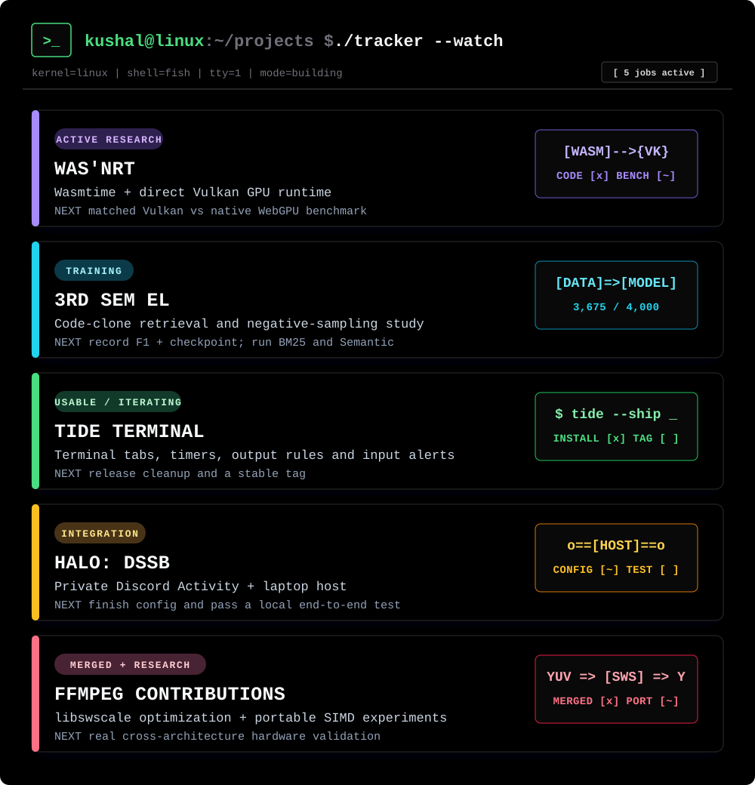

# Kushal Gowda S

Systems, machine learning, developer tools, and open-source experiments—with the evidence attached.

## Project links

- **[WAS'NRT](https://github.com/ksu-gitreaper807/gpuwasm)** · [PR #7](https://github.com/ksu-gitreaper807/gpuwasm/pull/7)
- **[3rd Sem EL](https://github.com/ksu-gitreaper807/EmbedEd)**
- **[Tide Terminal](https://github.com/ksu-gitreaper807/tide-terminal)**
- **[HALO: DSSB](https://github.com/k-karthik-pai/halo-discord)**
- **[FFmpeg contribution](https://code.ffmpeg.org/FFmpeg/FFmpeg/pulls/25859)** · [Bayer validation harness](https://github.com/ksu-gitreaper807/ffmpeg-bayer-cfarm-validation)

[Portfolio](https://github.com/ksu-gitreaper807/Portfolio) · [LinkedIn](https://www.linkedin.com/in/kushal-gowda-a86508376/) · [LeetCode](https://leetcode.com/u/SuedForAdultery/)

Tracker updated 27 November 2026. Research and performance claims remain provisional until their linked validation steps are complete.
